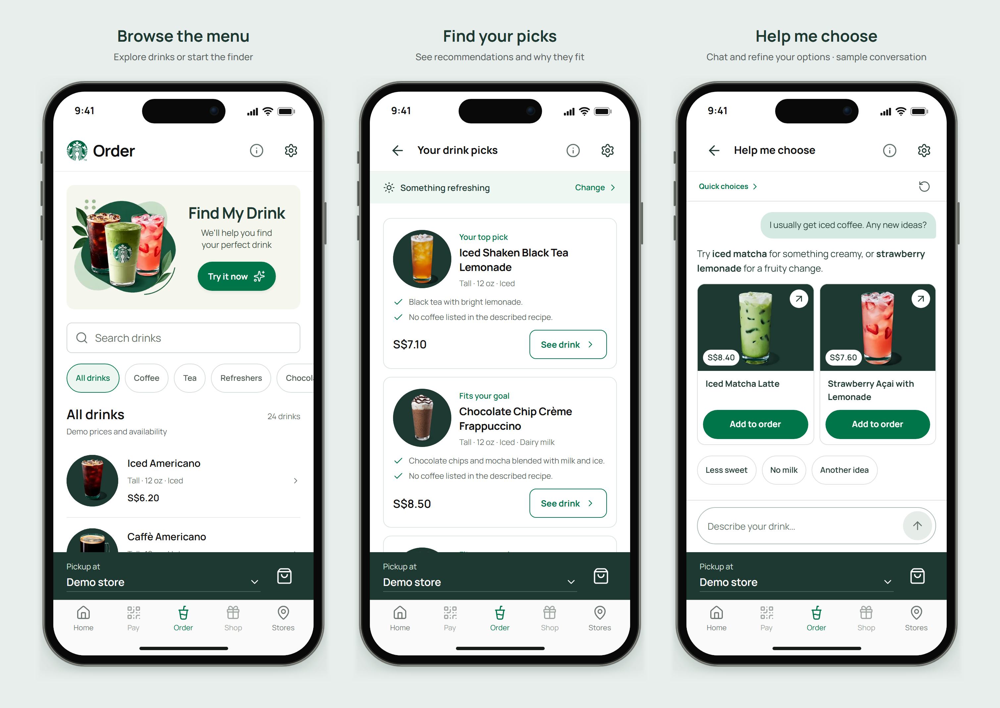
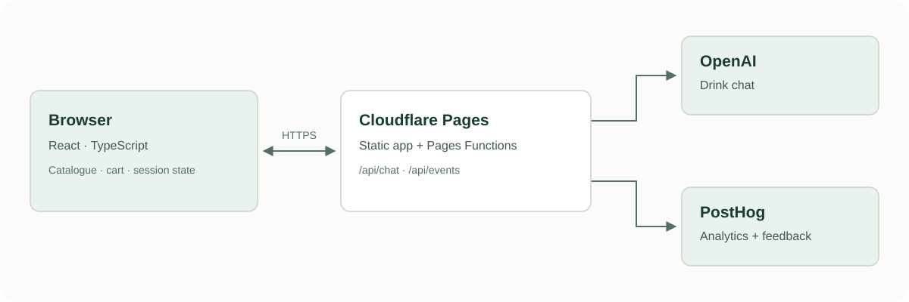

# Find My Drink

A Starbucks-inspired drink-discovery prototype. Choose through guided
preferences or AI chat, compare recipes, and select a size for a demo cart.

Built for NTU SC4025 Digital Product Management. The project focuses on improving
an existing product through product discovery, user flows and UI/UX design. The
working app demonstrates those design choices.

[Live demo](https://starbucks.utf.sh/) · [Setup & deployment](app/README.md) ·
[Software verification](tests/README.md)



## Architecture

React, TypeScript, Vite and Tailwind CSS power the interface. Catalogue matching,
the cart and session state stay in the browser. Cloudflare Pages serves the app;
Pages Functions connect to OpenAI and PostHog with server-side keys.



## Engineering highlights

| Capability | Implementation |
| --- | --- |
| Explainable matching | Shared 24-recipe catalogue. Stock, temperature, coffee and milk filters precede goal and sweetness ranking, and determine available preferences. |
| Catalogue-grounded chat | Structured replies, bounded history and allowlisted tools. Server checks enforce catalogue IDs, stock and preferences. |
| Size-aware ordering | Integer-cent prices. Size edits preserve quantities and merge matching cart lines. Chat additions confirm size first. |
| Interaction continuity | View Transitions connect drink photos, names and quick replies. Focus, scroll restoration and reduced-motion fallbacks support navigation. |
| Asset delivery | WebP photos, responsive banner preloads and immutable asset caching. Chat and feedback UI load on demand. |
| Feedback and privacy | Same-origin events, remembered votes and prompt cooldowns. Opt-out, Do Not Track and Global Privacy Control stop collection. |

Vitest covers critical rules and API handlers. Playwright checks the main browser
flows with model and telemetry requests mocked or blocked. See
[software verification](tests/README.md), [chat architecture](docs/chat-cloudflare-architecture.md)
and [analytics and privacy](docs/analytics-options.md).

## Run locally

Use Node.js 24 and npm.

```sh
git clone https://github.com/faqihxdev/sc4025-dpm.git
cd sc4025-dpm
cd app
npm ci
npm run dev -- --strictPort
```

Open [127.0.0.1:4177](http://127.0.0.1:4177/). Browsing, guided recommendations
and the cart work immediately. For AI chat, add your own OpenAI key to the ignored
root `.env` and follow the [backend setup](app/README.md#optional-ai-chat).

The [flow diagram and interactive wireframes](http://127.0.0.1:4177/#/wireframes)
run separately from the customer app, with annotations and print layouts.

Run checks from `app/`:

```sh
npm test
npm run build
npm run check:size
npm run test:e2e
```

Browser tests require `npx playwright install chromium`. The
[setup guide](app/README.md#checks) covers isolated browser checks, feedback
preview and the existing size-budget warnings.

## Project scope

The prototype covers discovery through adding to a demo cart. Prices, stock and
order history are simulated. Research, the report and presentation are maintained
separately from the code.

Chat sends messages to OpenAI. Production events and optional feedback use
PostHog; misuse-closed chats can include up to three recent user messages with
best-effort redaction. Product photos and the logo belong to Starbucks. See
[demo boundaries](app/README.md#demo-boundaries).

## Contributing

<details>
<summary>Team workflow and naming</summary>

- Branch: `<name>/<type>-<lowercase-kebab-description>`
- PR title and commit subject: `<type>: <short description>`
- Types: `feat`, `fix`, `refactor`, `docs`, `test`, `chore`
- GitHub Actions blocks invalid branch names and PR titles. Commit-subject
  findings are advisory so shared history does not need to be rewritten.
- Keep each pull request focused on one reviewable outcome.
- In the PR description, explain what changed, why, and how it was validated.
- Preserve shared history; do not rewrite pushed commits merely to rename them.
- Keep changes within the agreed MVP. Update the setup guide when commands or
  configuration change, and add tests for consequential rules and flows.
- Keep secrets, generated output, course documents and participant data out of
  Git. Use example variable names when documenting configuration.

Examples:

```text
faqih/docs-local-setup
siwen/feat-group-order-flow
docs: document local development setup
feat: add separate payment to group order
```

Before working, update your local `main` and create a named branch:

```sh
git switch main
git pull --ff-only
git switch -c yourname/feat-short-description
git config commit.template .gitmessage
```

Run the relevant checks before committing. Push your branch and open a pull
request against `main`. A Cloudflare deployment is separate from a Git push.

</details>
